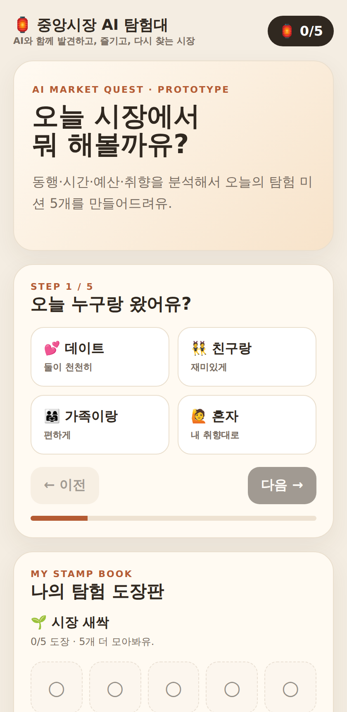
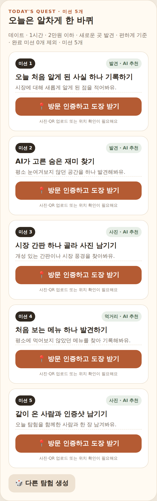
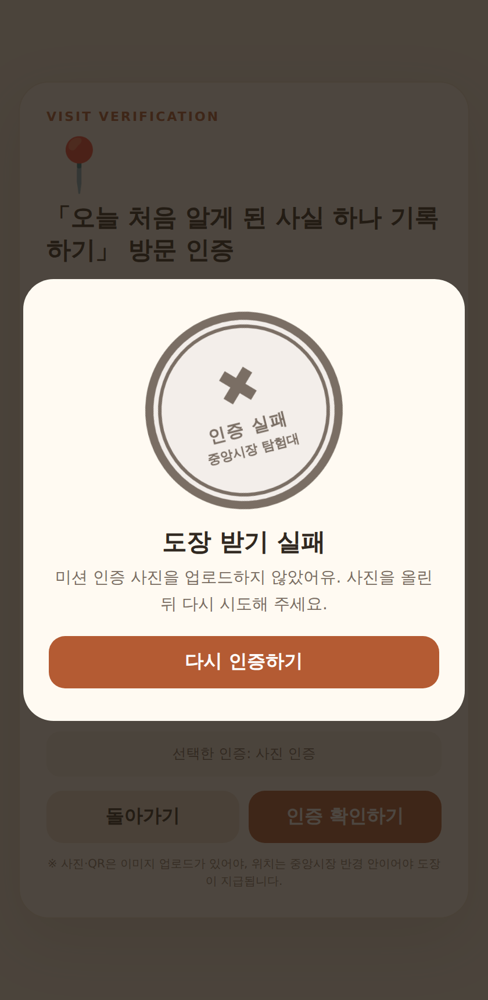
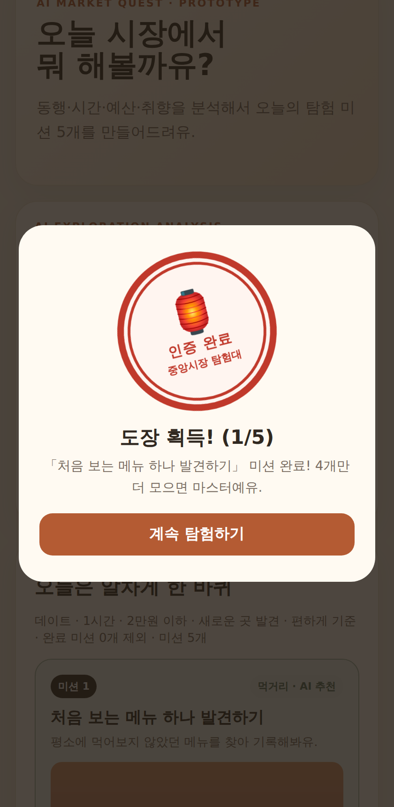
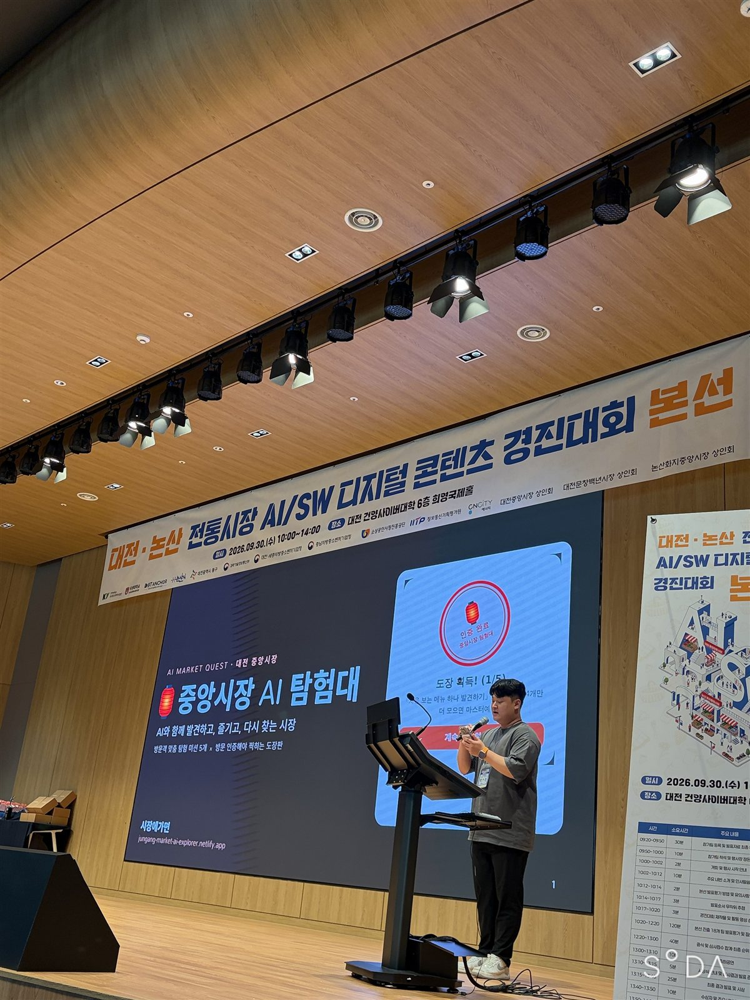
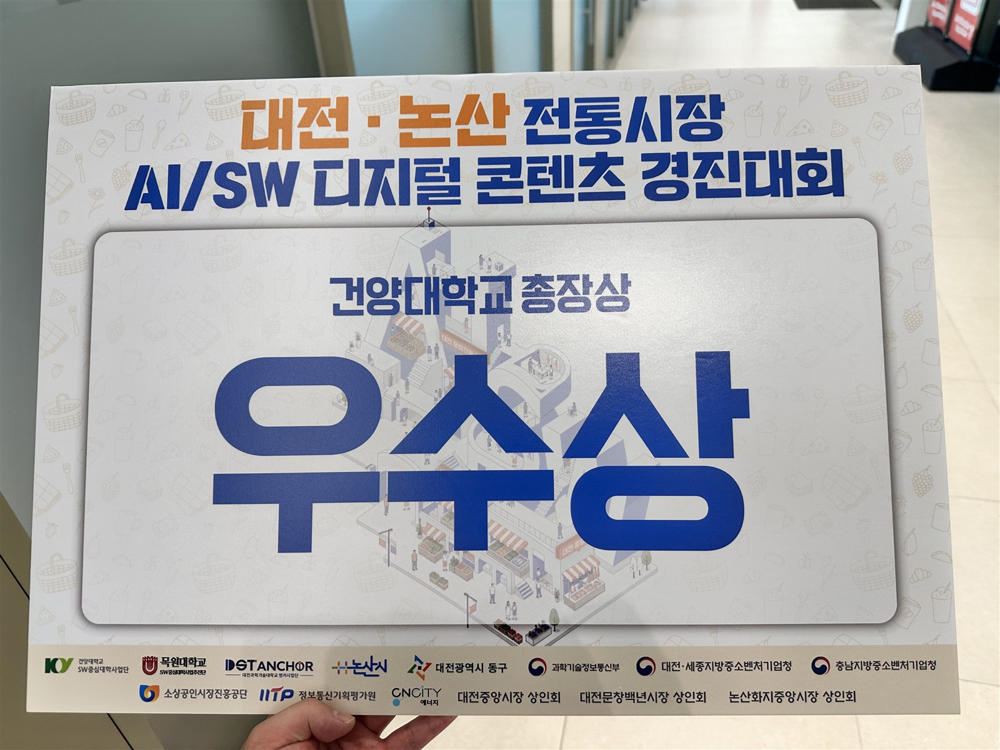
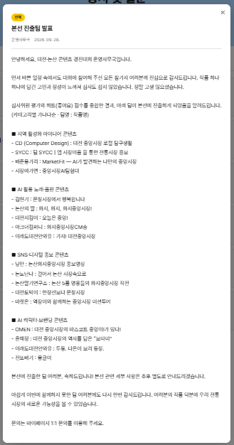
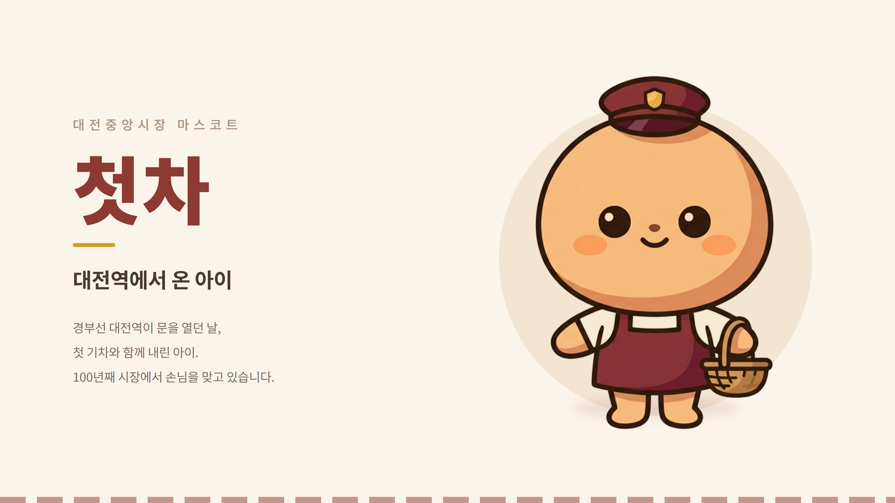
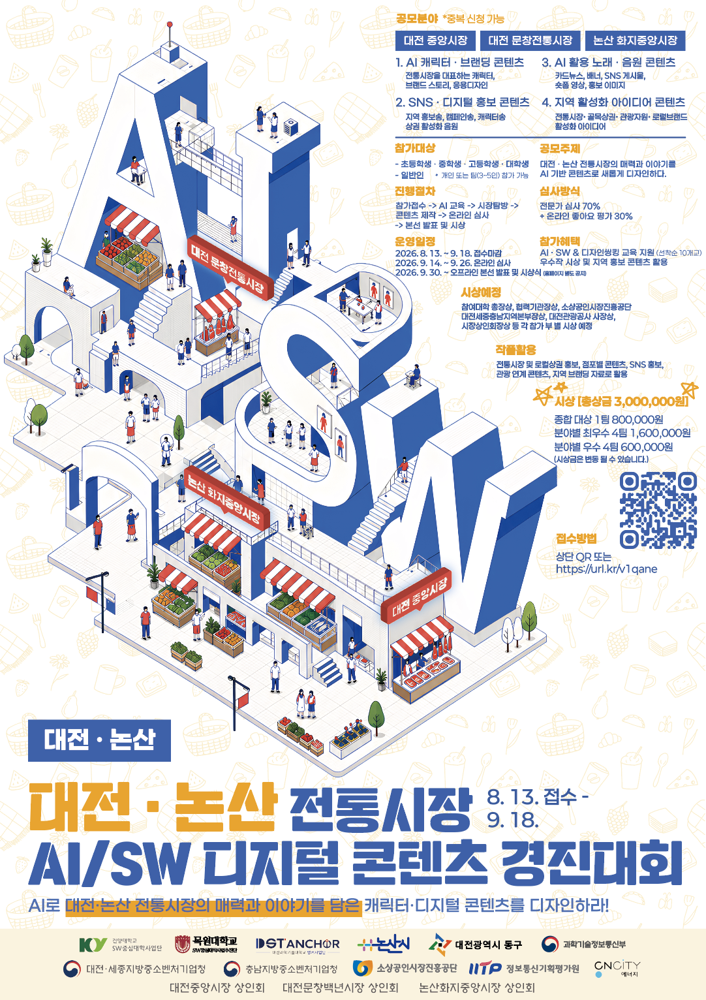

# 대전·논산 로컬상권 AI·SW 디지털 콘텐츠 경진대회 — 팀 시장에가면

> **대전 중앙시장**을 주제로 AI 캐릭터 · AI 노래 · 지역 활성화 아이디어 3개 부문에 참가한 팀 프로젝트

🏆 **우수상 (건양대학교 총장상)** — 지역 활성화 아이디어 콘텐츠 부문 「중앙시장 AI 탐험대」 (예선 142팀 중 본선 18팀, 해당 부문 4팀) · 본선 발표 및 시상식 2026.09.30.

| 부문 | 작품 | 제작 | 결과 | 자세히 |
|---|---|---|---|---|
| 🏮 지역 활성화 아이디어 콘텐츠 | 중앙시장 AI 탐험대 (모바일 웹) | 공동 제작 (Claude 활용 개발 담당) | **🏆 우수상** (건양대학교 총장상) | [regional-idea](regional-idea/) · [Live Demo](https://jungang-market-ai-explorer.netlify.app/) |
| 🚂 AI 캐릭터·브랜딩 콘텐츠 | 마스코트 「첫차」 | 전체 직접 제작 | 예선 | [character-branding](character-branding/) |
| 🎵 AI 활용 노래·음원 콘텐츠 | 「대전 중앙시장 다 있슈~」 | 팀원 제작 | 예선 | [ai-song](ai-song/) |

---

## 🏮 지역 활성화 아이디어 콘텐츠 — 중앙시장 AI 탐험대 🏆 우수상

> 방문객의 동행·시간·예산·취향을 분석해 **대전 중앙시장 맞춤 탐험 미션 5개**를 만들고, **방문 인증에 성공해야만 도장을 주는** 모바일 웹 프로토타입

**🔗 Live Demo:** https://jungang-market-ai-explorer.netlify.app/

| 조건 선택 | 미션 5개 생성 | 인증 실패 | 도장 획득 |
|:---:|:---:|:---:|:---:|
|  |  |  |  |

- 방문객이 입구 근처만 보고 떠나는 문제 → 조건별 탐험 미션으로 시장 안쪽까지 걷게 만들기
- 사진·QR 업로드 또는 GPS(시장 반경 700m) 확인이 있어야만 도장 지급, 5개 모으면 완주
- 외부 라이브러리 없는 HTML 파일 하나로 구현, ChatGPT·Claude를 개발 도구로 활용
- 팀원과 공동 제작 — **Claude를 활용한 코드 리뷰·버그 수정·기능 보완·배포본 검증은 직접 담당**

### 본선 결과 — 🏆 우수상 (건양대학교 총장상)

- 예선 **142팀** 중 4개 부문 합계 **18팀**이 본선 진출 (지역 활성화 아이디어 부문은 4팀)
- 본선: 2026.09.30. 건양사이버대학교 희영국제홀, 팀별 5분 발표 + 질의응답 → **우수상 (건양대학교 총장상)** 수상
- 📑 본선 발표 자료: [`regional-idea/presentation/jungang-market-ai-explorer-finals.pdf`](regional-idea/presentation/jungang-market-ai-explorer-finals.pdf)

| 본선 발표 | 우수상 수상 |
|:---:|:---:|
|  |  |

<details><summary>본선 진출팀 발표 (2026.09.28)</summary>



</details>

👉 [기획 배경, 핵심 로직, 트러블슈팅 보기](regional-idea/README.md)

## 🚂 AI 캐릭터·브랜딩 콘텐츠 — 마스코트 「첫차」



> 경부선 대전역이 문을 열던 날, 첫 기차와 함께 내린 아이. 100년째 시장에서 손님을 맞고 있습니다.

- 대전역(역장 모자)과 중앙시장(앞치마·장바구니)을 합친 대전 중앙시장 마스코트
- 모양·색·스타일을 항목별로 지정한 프롬프트로 이미지 생성 AI를 활용해 **전체 직접 제작**

👉 [캐릭터 소개와 생성 프롬프트 보기](character-branding/README.md)

## 🎵 AI 활용 노래·음원 콘텐츠 — 「대전 중앙시장 다 있슈~」

> 대전 중앙시장, 없는 게 없슈! 국악에 얹은 중독성 있는 홍보송

- **Suno**로 만든 국악 퓨전 홍보송 (2분 33초, 팀원 제작)
- 충청도 말투와 국악 추임새(얼쑤, 지화자)로 시장 먹거리와 인심을 노래
- 음원: [`ai-song/daejeon-jungang-market-song.mp3`](ai-song/daejeon-jungang-market-song.mp3)

👉 [가사 전체 보기](ai-song/README.md)

---

## 대회 안내

| 항목 | 내용 |
|---|---|
| 대회 | 대전·논산 로컬상권 AI·SW 디지털 콘텐츠 경진대회 |
| 팀 | **시장에가면** |
| 담당 | **AI 캐릭터·브랜딩 콘텐츠** — 전체 직접 제작<br>**지역 활성화 아이디어 콘텐츠** — 팀원과 공동 제작, Claude 활용 개발 담당 |
| 공모분야 | AI 캐릭터·브랜딩 / SNS·디지털 홍보 / AI 활용 노래·음원 / 지역 활성화 아이디어 (중복 신청 가능, 팀은 SNS·디지털 홍보 제외 3개 참가) |
| 대상 시장 | 대전 중앙시장 · 대전 문창전통시장 · 논산 화지중앙시장 |
| 심사방식 | 전문가 심사 70% + 온라인 좋아요 평가 30% |
| 일정 | 접수 2026.8.13.~9.18. · 온라인 심사 9.14.~9.26. · 오프라인 본선 발표 및 시상식 9.30. |
| 본선 안내 | [`docs/finals-guide.pdf`](docs/finals-guide.pdf) |



## 저장소 구조

```
daejeon-nonsan-aisw-contest/
├── README.md               # 대회 개요 (이 문서)
├── docs/                   # 대회 포스터, 본선 진출팀 발표, 본선 안내문, 본선 발표·수상 사진
│   ├── award-excellence.jpg
│   ├── contest-poster.png
│   ├── finalist-announcement.png
│   ├── finals-guide.pdf
│   └── finals-presentation.jpg
├── regional-idea/          # 지역 활성화 아이디어 — 중앙시장 AI 탐험대 (우수상)
│   ├── README.md
│   ├── index.html
│   ├── PROMPT.md
│   ├── docs/               # 스크린샷, 단계별 사용 프롬프트
│   └── presentation/       # 본선 발표 자료
├── character-branding/     # AI 캐릭터·브랜딩 — 마스코트 「첫차」
│   ├── README.md
│   └── mascot-cheotcha.png
└── ai-song/                # AI 활용 노래·음원 — 「대전 중앙시장 다 있슈~」
    ├── README.md
    └── daejeon-jungang-market-song.mp3
```
